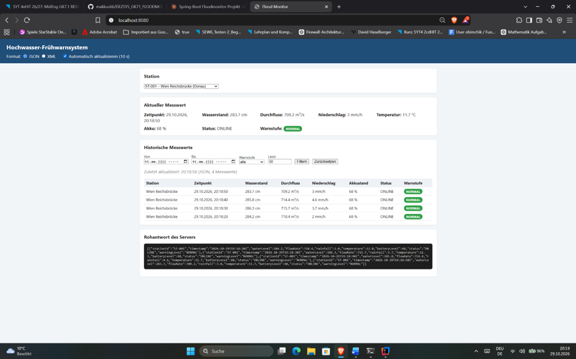
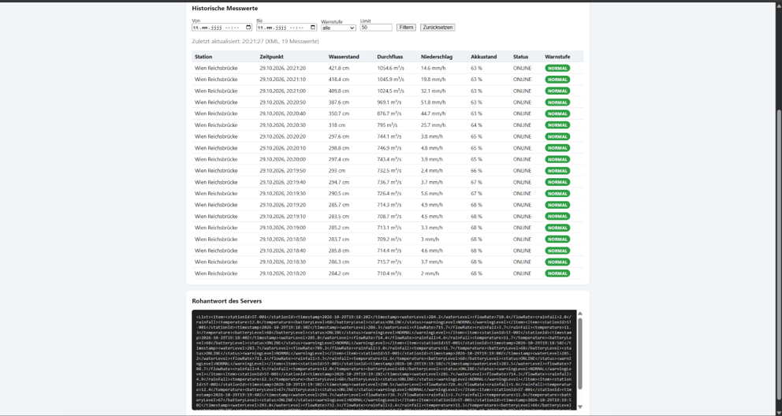
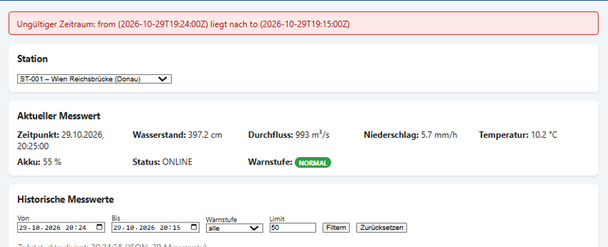
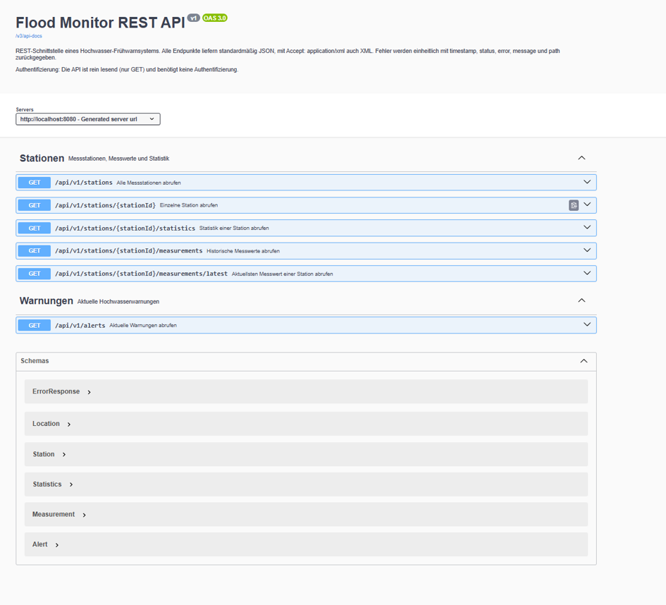

# DEZSYS_GK71_FLOODMONITOR_REST

**Autor:** Muhammed Akkus, 4CHIT
**Datum:** 29.10.2026

REST-Schnittstelle für ein Hochwasser-Frühwarnsystem mit Spring Boot. Mehrere Messstationen erzeugen simulierte Messwerte (Wasserstand, Durchfluss, Niederschlag, Temperatur, Akkustand). Die Daten sind über eine REST-API als **JSON** oder **XML** abrufbar und werden in einem **jQuery-Webclient** angezeigt.

---

## Inhalt

1. [Startanleitung](#startanleitung)
2. [Konfiguration](#konfiguration)
3. [Architektur](#architektur)
4. [Datenmodell](#datenmodell)
5. [Simulationsregeln](#simulationsregeln)
6. [Warnstufen](#warnstufen)
7. [REST-Schnittstelle](#rest-schnittstelle)
8. [Beispiele JSON und XML](#beispiele-json-und-xml)
9. [Fehlerbehandlung](#fehlerbehandlung)
10. [Webclient](#webclient)
11. [Tests](#tests)
12. [API-Dokumentation (OpenAPI)](#api-dokumentation-openapi)
13. [Reflexion](#reflexion)

---

## Startanleitung

**Voraussetzungen:** Java 17 oder höher (getestet mit Java 23). Gradle muss nicht installiert sein, der Gradle Wrapper ist im Projekt enthalten.

```bash
# Windows
.\gradlew.bat bootRun

# Linux / macOS
./gradlew bootRun
```

Danach erreichbar unter:

| Was | URL |
|---|---|
| Webclient | http://localhost:8080/ |
| REST-API | http://localhost:8080/api/v1/stations |
| Swagger UI | http://localhost:8080/swagger-ui.html |
| OpenAPI (JSON) | http://localhost:8080/v3/api-docs |

Tests ausführen:

```bash
.\gradlew.bat test
```

---

## Konfiguration

`src/main/resources/application.properties` (enthält keine geheimen Zugangsdaten):

```properties
server.port=8080

# Simulation
simulation.enabled=true
simulation.interval=10000
```

| Eigenschaft | Bedeutung |
|---|---|
| `server.port` | Port des Servers |
| `simulation.enabled` | Simulation ein/aus (in den Tests auf `false`) |
| `simulation.interval` | Intervall der Simulation in Millisekunden |

---

## Architektur

```
src/main/java/com/example/floodmonitor/
├── FloodMonitorApplication.java
├── config/        OpenApiConfig
├── controller/    StationController, AlertController
├── exception/     GlobalExceptionHandler, ErrorResponse, NotFoundException, BadRequestException
├── model/         Station, Location, Measurement, Alert, Statistics, WarningLevel, StationStatus
├── repository/    StationRepository, MeasurementRepository
└── service/       StationService, MeasurementService, WarningLevelService, SimulationService

src/main/resources/static/
├── index.html
├── css/style.css
└── js/app.js
```

| Schicht | Aufgabe |
|---|---|
| **Model** | Datenklassen und Enums |
| **Repository** | Speichert Stationen und Messwerte im Arbeitsspeicher (max. 1000 Messwerte pro Station) |
| **Service** | Geschäftslogik: Filterung, Validierung, Statistik, Warnstufenberechnung, Simulation |
| **Controller** | Nimmt HTTP-Anfragen entgegen und ruft die Services auf, keine Geschäftslogik |
| **Exception Handling** | Zentrale Fehlerbehandlung mit `@RestControllerAdvice` |
| **Client** | Webclient mit HTML, CSS und jQuery |

---

## Datenmodell

**Station**

| Feld | Typ | Beschreibung |
|---|---|---|
| id | String | z. B. `ST-001` |
| name | String | Name der Station |
| river | String | Fluss |
| location | Location | Breitengrad und Längengrad |
| normalWaterLevel | double | normaler Wasserstand in cm |
| warningWaterLevel | double | Warnwert in cm |
| criticalWaterLevel | double | kritischer Wert in cm |
| isActive | boolean | Station aktiv |
| status | StationStatus | ONLINE, MAINTENANCE, OFFLINE |

**Measurement**

| Feld | Typ | Einheit |
|---|---|---|
| stationId | String | |
| timestamp | Instant | ISO-8601 (UTC) |
| waterLevel | double | cm |
| flowRate | double | m³/s |
| rainfall | double | mm/h |
| temperature | double | °C |
| batteryLevel | int | % |
| status | StationStatus | |
| warningLevel | WarningLevel | NORMAL, WARNING, CRITICAL, UNKNOWN |

**Stationen**

| ID | Name | Fluss | Normal | Warnung | Kritisch | Aktiv |
|---|---|---|---|---|---|---|
| ST-001 | Wien Reichsbrücke | Donau | 280 cm | 450 cm | 600 cm | ja |
| ST-002 | Linz Nibelungenbrücke | Donau | 300 cm | 550 cm | 700 cm | ja |
| ST-003 | Innsbruck Innbrücke | Inn | 200 cm | 350 cm | 450 cm | ja |
| ST-004 | Salzburg Staatsbrücke | Salzach | 250 cm | 450 cm | 600 cm | nein (OFFLINE) |

---

## Simulationsregeln

Der `SimulationService` erzeugt alle `simulation.interval` Millisekunden für jede **aktive** Station einen neuen Messwert. Jeder neue Wert baut auf dem **vorherigen Messwert** auf.

| Wert | Regel |
|---|---|
| Niederschlag | 60 % des vorherigen Werts + 0 bis 3 mm/h. Mit 10 % Wahrscheinlichkeit Starkregen (+10 bis 30 mm/h). Begrenzt auf 0 bis 60 mm/h. |
| Wasserstand | vorheriger Wert + 0,8 cm pro mm/h Niederschlag − 5 % der Abweichung zum Normalwert + kleine Schwankung. Nie negativ. |
| Durchfluss | 2,5 × Wasserstand, steigt also mit dem Wasserstand |
| Temperatur | vorheriger Wert ± kleine Schwankung, begrenzt auf −20 bis 40 °C |
| Akkustand | sinkt mit 30 % Wahrscheinlichkeit um 1 %. Unter 10 % wechselt die Station auf MAINTENANCE und lädt dann um 20 % pro Messung, bei 100 % wieder ONLINE. |
| Inaktive / OFFLINE-Stationen | bekommen keine neuen Messwerte |

Dadurch steigt der Wasserstand bei Regen und fällt danach langsam wieder auf den Normalwert zurück, statt zufällig zu springen.

---

## Warnstufen

Die Warnstufe wird **nur am Server** im `WarningLevelService` berechnet:

| Bedingung | Warnstufe |
|---|---|
| keine Messung, Messung älter als 5 Minuten oder Wasserstand ungültig | UNKNOWN |
| Wasserstand ≥ kritischer Wert | CRITICAL |
| Wasserstand ≥ Warnwert | WARNING |
| sonst | NORMAL |

Niederschlag und Anstiegsgeschwindigkeit werden nicht direkt verwendet, weil der Niederschlag in der Simulation bereits den Wasserstand erhöht.

---

## REST-Schnittstelle

Basis-URL: `/api/v1`

| Methode | Endpunkt | Parameter | Beschreibung |
|---|---|---|---|
| GET | `/stations` | `river`, `isActive`, `warningLevel` | Alle Stationen (filterbar) |
| GET | `/stations/{stationId}` | | Einzelne Station |
| GET | `/stations/{stationId}/measurements/latest` | | Aktuellster Messwert |
| GET | `/stations/{stationId}/measurements` | `from`, `to`, `limit`, `warningLevel` | Historische Messwerte |
| GET | `/stations/{stationId}/statistics` | `from`, `to` | Statistik |
| GET | `/alerts` | `river`, `warningLevel` | Aktuelle Warnungen (WARNING / CRITICAL) |

- `from` / `to`: ISO-8601, z. B. `2026-05-01T08:00:00Z`
- `limit`: 1 bis 1000, Standard 100 (es werden die neuesten Messwerte geliefert)

Die **Statistik** enthält: niedrigsten, höchsten und durchschnittlichen Wasserstand, durchschnittlichen Durchfluss, Niederschlagssumme, Anzahl der Messungen, Anzahl der WARNING-Messungen (`warningCount`) und Anzahl der CRITICAL-Messungen (`criticalCount`).

**Authentifizierung:** Die API bietet nur lesende GET-Endpunkte für öffentliche Messdaten und benötigt daher keine Authentifizierung.

---

## Beispiele JSON und XML

Das Format wird über den `Accept`-Header gewählt. Ohne Header wird JSON geliefert.

> Unter Windows PowerShell `curl.exe` statt `curl` verwenden.

**JSON**

```bash
curl.exe -H "Accept: application/json" http://localhost:8080/api/v1/stations/ST-001/measurements/latest
```

```json
{
  "stationId": "ST-001",
  "timestamp": "2026-10-29T19:02:50Z",
  "waterLevel": 306.4,
  "flowRate": 766.0,
  "rainfall": 2.9,
  "temperature": 11.9,
  "batteryLevel": 72,
  "status": "ONLINE",
  "warningLevel": "NORMAL"
}
```

**XML**

```bash
curl.exe -H "Accept: application/xml" http://localhost:8080/api/v1/stations/ST-001/measurements/latest
```

```xml
<measurement>
  <stationId>ST-001</stationId>
  <timestamp>2026-10-29T19:03:50Z</timestamp>
  <waterLevel>338.4</waterLevel>
  <flowRate>846.0</flowRate>
  <rainfall>4.0</rainfall>
  <temperature>12.2</temperature>
  <batteryLevel>71</batteryLevel>
  <status>ONLINE</status>
  <warningLevel>NORMAL</warningLevel>
</measurement>
```

**Gefilterte Abfragen**

```bash
curl.exe "http://localhost:8080/api/v1/stations?river=Donau"
curl.exe "http://localhost:8080/api/v1/stations/ST-001/measurements?from=2026-10-29T19:00:00Z&to=2026-10-29T20:00:00Z&limit=10"
curl.exe "http://localhost:8080/api/v1/alerts?warningLevel=CRITICAL"
```

---

## Fehlerbehandlung

Alle Fehler werden zentral im `GlobalExceptionHandler` behandelt und einheitlich zurückgegeben (JSON oder XML je nach Accept-Header, ohne Stacktrace):

```json
{
  "timestamp": "2026-10-29T19:10:40Z",
  "status": 404,
  "error": "Not Found",
  "message": "Station ST-999 wurde nicht gefunden",
  "path": "/api/v1/stations/ST-999"
}
```

| Situation | Statuscode |
|---|---|
| Unbekannte Station / noch keine Messwerte / unbekannter Pfad | 404 Not Found |
| `from` nach `to` | 400 Bad Request |
| Ungültiges Datumsformat | 400 Bad Request |
| Ungültige Warnstufe | 400 Bad Request |
| `limit` kleiner 1 oder größer 1000 | 400 Bad Request |
| Nicht unterstütztes Format (z. B. `Accept: text/plain`) | 406 Not Acceptable |
| Nicht unterstützter Medientyp im Request | 415 Unsupported Media Type |
| Falsche HTTP-Methode | 405 Method Not Allowed |
| Unerwarteter Fehler | 500 Internal Server Error |

---

## Webclient

Erreichbar unter http://localhost:8080/ (HTML, CSS, jQuery).

Funktionen:
- Stationen laden und auswählen
- aktuellen Messwert anzeigen
- historische Messwerte als Tabelle (Station, Zeitpunkt, Wasserstand, Durchfluss, Niederschlag, Akkustand, Status, Warnstufe)
- Filter nach Zeitraum, Warnstufe und Anzahl
- Umschalten zwischen JSON und XML (bei XML wird die XML-Antwort ausgewertet)
- automatische Aktualisierung alle 10 Sekunden
- Ladeanzeige und verständliche Fehlermeldungen
- Farben: NORMAL grün, WARNING orange, CRITICAL rot, UNKNOWN grau

**JSON-Ansicht**



**XML-Ansicht**



**Fehlermeldung bei ungültigem Zeitraum**



---

## Tests

13 automatisierte Tests mit JUnit 5 und MockMvc. In den Tests ist die Simulation mit `simulation.enabled=false` deaktiviert, und vor jedem Test werden feste Messwerte angelegt. Die Tests sind dadurch nicht vom Zufall abhängig.

| Test aus der Angabe | Testmethode |
|---|---|
| Alle Stationen als JSON | `allStationsAsJson` |
| Alle Stationen als XML | `allStationsAsXml` |
| Existierende Station | `existingStation` |
| Unbekannte Station | `unknownStation` |
| Aktuellster Messwert | `latestMeasurement` |
| Filterung nach Zeitraum | `filterByTimeRange` |
| Ungültiger Zeitraum | `invalidTimeRange` |
| Warnstufe NORMAL | `normalBelowWarningLevel` |
| Warnstufe WARNING | `warningFromWarningLevel` |
| Warnstufe CRITICAL | `criticalFromCriticalLevel` |
| Nicht unterstütztes Format | `unsupportedFormat` |
| Maximales Limit | `maxLimit` |

---

## API-Dokumentation (OpenAPI)

Die API ist mit **springdoc-openapi** dokumentiert (Endpunkte, Methoden, Parameter, Response-Bodies, Formate, Statuscodes, Fehlerantworten, Authentifizierung).

- Swagger UI: http://localhost:8080/swagger-ui.html
- Spezifikation im Repository: [`docs/openapi.yaml`](docs/openapi.yaml)



---

## Reflexion

Während der Umsetzung sind folgende Probleme aufgetreten:

- **„detected dubious ownership"** beim ersten `git push`: Das Projekt lag zuerst auf Laufwerk D:, das keine Dateibesitzer speichert. Gelöst mit `git config --global --add safe.directory`.
- **„Unsupported class file major version 67"**: Das Starter-Projekt verwendete Gradle 8.7, das mein installiertes Java 23 nicht unterstützt. Ich habe den Gradle Wrapper auf 8.10.2 aktualisiert.
- **Zwei Projektkopien:** IntelliJ hatte einen anderen Ordner geöffnet als mein Terminal, deshalb wirkten Änderungen scheinbar nicht. Ab dann habe ich nur noch das Terminal in IntelliJ verwendet.
- **„Invalid fixedRateString value"**: Ich hatte versehentlich einen Git-Befehl in die `application.properties` statt ins Terminal geschrieben.
- **Fehlender Logger:** Beim Umbau des Konstruktors im `SimulationService` ist die Logger-Zeile verloren gegangen, was zu einem Kompilierfehler führte.
- **Rote Imports in IntelliJ:** Nach dem Hinzufügen von Jackson XML musste ich das Gradle-Projekt in IntelliJ neu laden.
- **curl in PowerShell:** `curl` ist in PowerShell ein Alias für `Invoke-WebRequest`. Für die Tests habe ich `curl.exe` verwendet.
- **Fehlermeldung bei 406:** Bei einem nicht unterstützten Accept-Header kann der Fehler selbst nicht im gewünschten Format ausgegeben werden. Ich setze dort den Content-Type fest auf JSON.

**Was ich gelernt habe:** wie man eine REST-Schnittstelle in Schichten aufbaut, wie Content Negotiation über den Accept-Header funktioniert, wie man Fehler zentral behandelt und wie man Tests unabhängig von zufälligen Daten macht.
